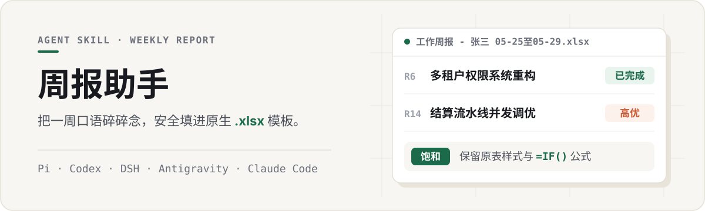
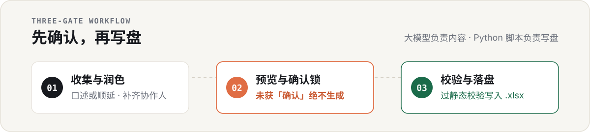
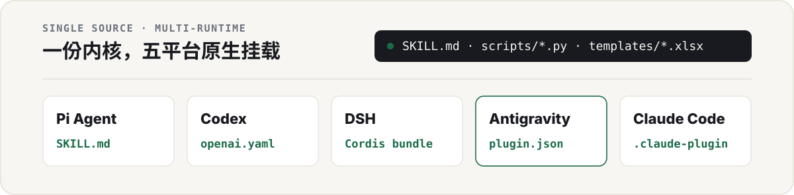

<p align="center">
  
</p>

<p align="center">
  <a href="https://agentskills.io"></a>
  <a href="#多平台兼容与外置框架适配"></a>
  <a href="#校验与测试"></a>
  <a href="LICENSE"></a>
</p>

**周报助手（Weekly Report Skill）** 把写周报拆成两段明确分工：**内容提炼交给大模型，校验与写盘交给确定性 Python 脚本**。你只需用自然语言口述一周工作，AI 完成职场化重构并在确认后以单元格级精度填入原生 `.xlsx` 模板，完整保留表头配色、合并单元格、边框与进度公式。

---

## 真实效果：口语碎碎念到正式周报

### 1. 职场化润色对照

润色遵循 **【精准动作动词】+【业务系统/功能模块】+【具体手段/工作重心】+【阶段成果/业务价值】** 公式，只提升表达精度，不编造未发生的事实、数据或协作人（详见 [`references/polishing.md`](references/polishing.md)）：

| 原始口语输入 | 职场规范化呈现（写入 Excel 内容） |
| --- | --- |
| "改了结算流水线的并发 bug" | **排查并修复订单结算流水线并发冲突异常，优化分布式锁边界校验，确保交易幂等无误** |
| "跟产品对了多租户权限二期" | **参与用户中心多租户权限系统业务需求评审，对齐核心角色鉴权规则与验收标准，完成技术任务拆解** |
| "写了几个接口并自测" | **完成核心业务模块 RESTful 接口开发与联调，通过接口幂等性验证与单元测试覆盖** |
| "线上有点卡，查了下" | **排查并定位生产环境服务响应延迟瓶颈，优化慢查询 SQL 索引与缓存策略，提升接口响应效率** |

### 2. 端到端交互示例

```text
用户：帮我写下本周周报，这周我排查了结算流水线的慢查询，另外完成了多租户权限接口开发，下周准备做订单网关回归测试。

AI：已为你做职场化提炼，请补充以下关键细节：
  1. 结算慢查询优化的完成状态是已完成吗？
  2. 多租户权限接口联调的协作人是谁？
  3. 下周订单网关回归测试的计划起止时间是？

用户：慢查询已完成；协作人是李四；下周一到周三做网关回归。

AI：[门 2] 预览与确认 — preconditions: PASS
  周报预览
  - 周期：2026/05/25 - 2026/05/29
  - 姓名/部门：张三 / 核心业务研发部
  --------------------------------------------------
  1. 上周完成情况：
     - [已完成] 排查并定位生产环境订单结算响应延迟瓶颈，优化慢查询 SQL 索引
  2. 本周重点工作：
     - [高] 推进用户中心多租户权限 RESTful 接口开发与联调（协作人：李四）
  3. 下周工作计划：
     - [高] 推进异步消息通知网关核心业务流回归测试与发布验证（2026-06-01至2026-06-03）
  4. 饱和度评估：
     - 饱和度：饱和（双线并行推进，开发与性能优化进度符合预期）
  --------------------------------------------------
  请确认以上内容无误，回复「确认」后我将基于企业标准 Excel 模板生成文件。

用户：确认

AI：[门 3] 校验 → 生成 → 交付 — preconditions: PASS
  校验：validate_payload → ok
  生成：generate_report  → success
  文件路径：~/Desktop/周报/工作周报 - 张三 2026-05-25至2026-05-29.xlsx
```

---

## 工作原理：三道门与确定性分工

<p align="center">
  
</p>

| 阶段 | 负责方 | 核心约束与不通过后果 |
| --- | --- | --- |
| **门 1 · 收集与润色** | 大模型 + `fields.md` / `polishing.md` | 核齐四大板块、周期与每条协作人；支持 `--migrate-last-week` 从上周顺延建议起步；缺项最多追问 2 轮 |
| **门 2 · 预览与确认锁** | 大模型 + 用户显式回复 | 必须输出完整 Markdown 预览卡片并获明确「确认」；未确认前**绝不提前生成文件** |
| **门 3 · 校验与原生落盘** | `validate_payload.py` + `generate_report.py` | 严禁用文本工具直接改 `.xlsx`；先过静态校验再由 `openpyxl` 单元格级写入，校验不通过拒绝写盘 |

写盘前由纯标准库脚本 `scripts/validate_payload.py` 做静态拦截，所有报错精确到字段路径：

```json
{
  "status": "invalid",
  "errors": [
    "this_week[0]: 协作人未填 —— 铁律要求必须主动询问，不能留空带队",
    "last_week[0]: status 只能取 已完成/进行中/未开始/延期，当前 '搞定'",
    "next_week[1]: 缺少必填字段 eta"
  ]
}
```

---

## 多平台兼容与外置框架适配

本仓库采用 **单源内核 + 轻量外置清单（Single Source + Thin Wrappers）** 设计：`SKILL.md`、参考文档、工作流、Python 脚本与默认模板只维护一份在仓库根目录；各平台独有的插件清单、图标与注册入口存放在 `platforms/` 下，由安装脚本按目标平台自动组装，无需维护多份重复副本。

<p align="center">
  
</p>

### 平台外置框架差异对照

| 平台 | 默认安装路径（轻量 Skill） | 外置框架 / 插件形态 | 对应仓内适配文件 | 生效方式 |
| --- | --- | --- | --- | --- |
| **Pi Agent** | `~/.pi/agent/skills/weekly-report/` | 原生识别目录根 `SKILL.md`（无需额外清单） | 根目录 `SKILL.md` | 在 Pi 会话执行 `/reload` |
| **Codex** | `~/.codex/skills/weekly-report/` | UI 元数据 `agents/openai.yaml`；插件形态另需 `.codex-plugin/plugin.json` | `agents/openai.yaml`、`platforms/codex/` | 自动发现，可用 `$weekly-report` 唤醒 |
| **DeepSeek Harness (DSH)** | `~/.dsh/skills/weekly-report/` 或 `<workspace>/.dsh/skills/weekly-report/` | 支持直接装入 `skills/`，或以 Cordis 原生 bundle 挂载（`ctx.skills.register()`） | `platforms/dsh/`（`package.json`、`cordis.patch.yml`、`index.js`、`icon.svg`） | 直装自动发现；bundle 形态写入 `dsh.profile.bundles` |
| **Antigravity (AGY)** | `~/.gemini/config/skills/weekly-report/` 或 `<workspace>/.agents/skills/weekly-report/` | 全局插件需在 `~/.gemini/config/plugins/weekly-report/` 放置 `plugin.json`、`assets/logo.svg` 与 `skills/weekly-report/` | `platforms/antigravity/`（`plugin.json`、`assets/logo.svg`） | 插件加载后可在定制页启停，可用 `agy plugin validate --strict` 校验 |
| **Claude Code** | `~/.claude/skills/weekly-report/` | 原生识别 `SKILL.md`；插件市场形态使用 `.claude-plugin/` | `platforms/claude-code/`（`plugin.json`、`marketplace.json`） | 自动发现，按描述触发或手动调用 |
| **OpenCode** | `~/.config/opencode/superpowers/skills/weekly-report/` | 原生识别目录根 `SKILL.md` | 根目录 `SKILL.md` | 启动或重载后生效 |

---

## 快速开始

### 1. 环境准备

生成引擎依赖 Python 3.9+ 与 `openpyxl`（载荷校验器 `validate_payload.py` 仅使用 Python 标准库，无第三方依赖）：

```bash
pip install openpyxl
```

### 2. 一键安装到指定平台（推荐）

克隆仓库后，通过跨平台安装脚本按需安装到任意一个或多个平台。脚本会自动组装目标平台的外置包装，并**保留目标目录中你已放入的公司定制 `.xlsx` 模板**不被覆盖。

**Windows (PowerShell)：**

```powershell
git clone https://github.com/drydraft/weekly-report-skill.git
cd weekly-report-skill

# 安装到单个平台（可选：pi / codex / codex-plugin / dsh / dsh-bundle / antigravity / antigravity-skill / claude / claude-plugin / opencode / all）
powershell -NoProfile -ExecutionPolicy Bypass -File .\scripts\install.ps1 -Target antigravity

# 一次安装到五大主力平台（pi、codex、dsh、antigravity、claude）
powershell -NoProfile -ExecutionPolicy Bypass -File .\scripts\install.ps1 -Target all

# 仅演练查看目标路径，不写盘
powershell -NoProfile -ExecutionPolicy Bypass -File .\scripts\install.ps1 -Target all -DryRun
```

**macOS / Linux：**

```bash
git clone https://github.com/drydraft/weekly-report-skill.git
cd weekly-report-skill

# 安装到单个或多个平台
./scripts/install.sh antigravity
./scripts/install.sh pi codex dsh claude

# 一次安装到五大主力平台
./scripts/install.sh all
```

<details>
<summary>手动直接克隆安装命令（兼容旧版 git pull 方式）</summary>

根目录保留完整 Agent Skill 标准结构，支持直接克隆到各平台轻量技能目录：

```bash
# Pi Agent（克隆后在 Pi 中输入 /reload）
git clone https://github.com/drydraft/weekly-report-skill.git ~/.pi/agent/skills/weekly-report

# Codex（自动读取 agents/openai.yaml）
git clone https://github.com/drydraft/weekly-report-skill.git ~/.codex/skills/weekly-report

# DeepSeek Harness (DSH)
git clone https://github.com/drydraft/weekly-report-skill.git ~/.dsh/skills/weekly-report

# Claude Code
git clone https://github.com/drydraft/weekly-report-skill.git ~/.claude/skills/weekly-report

# Antigravity（轻量独立 Skill；如需完整插件管理页请使用上方 install 脚本）
git clone https://github.com/drydraft/weekly-report-skill.git ~/.gemini/config/skills/weekly-report

# OpenCode
git clone https://github.com/drydraft/weekly-report-skill.git ~/.config/opencode/superpowers/skills/weekly-report
```

</details>

### 3. 模板连通性自检

安装完成后执行模板校验，确认返回 `status: success` 及四个区块定位行号：

```bash
python scripts/generate_report.py --validate-template
```

Antigravity 插件用户可额外运行严格清单校验：

```bash
agy plugin validate ~/.gemini/config/plugins/weekly-report --strict
```

---

## CLI 工具链与自定义配置

### 命令行接口

```bash
# 0. 写盘前静态校验载荷（无第三方依赖）
python scripts/validate_payload.py payload.json

# 1. 验证 Excel 模板结构与四大区块定位行
python scripts/generate_report.py --validate-template

# 2. 根据已确认的 JSON 载荷生成 Excel 周报
python scripts/generate_report.py payload.json

# 3. 读取输出目录中最新一份周报的结构化数据
python scripts/generate_report.py --last-week

# 4. 提取上一份周报的跨周顺延迁移建议
python scripts/generate_report.py --migrate-last-week

# 5. 运行内置示例生成自检
python scripts/generate_report.py --test
```

`generate_report.py` 同样支持从 stdin 读取（`-`）及内联 JSON（`--json '<json>'`），完整数据结构与字段约束见 [`references/cli-and-payload.md`](references/cli-and-payload.md) 与 [`references/fields.md`](references/fields.md)。

### 环境变量与公司模板定制

无需修改脚本，通过环境变量即可切换模板与输出目录：

| 环境变量 | 说明 | 默认值 |
| --- | --- | --- |
| `WKR_TEMPLATE_PATH` | 自定义公司 Excel 周报模板路径 | `<skill_dir>/templates/工作周报模板.xlsx` |
| `WKR_OUTPUT_DIR` | 周报 `.xlsx` 默认输出目录 | `~/Desktop/周报/` |

使用自定义公司模板时，请显式设置 `WKR_TEMPLATE_PATH` 指向对应文件（仅将新模板放入 `templates/` 目录不会自动覆盖默认模板），然后运行 `--validate-template` 确认脚本能够识别 `上周工作完成情况`、`本周重要工作项`、`下周工作计划`、`工作饱和度评估` 四个 A 列区块标题。

---

## 校验与测试

```bash
# 运行全部 22 个单元测试（生成引擎 + 载荷校验器）
python -m unittest discover -s tests -v

# 或使用 pytest
python -m pytest tests/ -q

# 校验器独立试跑
python scripts/validate_payload.py --json '{"period":"2026/05/25-2026/05/29","name":"张三","department":"IT部","last_week":[],"this_week":[],"next_week":[]}'
```

行为验收规范定义在 [`evals/evals.json`](evals/evals.json)：必须按序通过三道门、饱和度固定写入「饱和」、文件名严格统一为 `工作周报 - {姓名} {起始}至{结束}.xlsx`。

---

## 项目结构

```text
weekly-report-skill/
├── SKILL.md                        # 核心技能规范：三道门控制流、硬门禁、按需加载路由
├── README.md                       # 项目说明与多平台安装指南
├── LICENSE                         # MIT License
├── agents/
│   └── openai.yaml                 # Codex UI 元数据（名称、简介、默认提示词）
├── platforms/                      # 轻量外置框架清单（单源复用，不复制 SKILL.md）
│   ├── antigravity/                #   Antigravity 插件清单（plugin.json + assets/logo.svg）
│   ├── codex/                      #   Codex 插件清单（.codex-plugin/plugin.json）
│   ├── claude-code/                #   Claude Code 插件与市场清单（.claude-plugin/）
│   └── dsh/                        #   DeepSeek Harness Cordis bundle（package.json + index.js + cordis.patch.yml）
├── references/                     # 按需加载的知识库
│   ├── fields.md                   #   四大板块必填字段、取值枚举、单元格映射
│   ├── polishing.md                #   职场化润色公式、转换对照表、真实性底线
│   └── cli-and-payload.md          #   CLI 接口、Payload 结构与环境变量
├── workflows/                      # 端到端操作流程
│   ├── A-new-report.md             #   全新周报填报流程
│   └── B-migrate-last-week.md      #   基于上周周报顺延更新流程
├── scripts/
│   ├── generate_report.py          #   Excel 生成引擎（openpyxl 单元格级写入）
│   ├── validate_payload.py         #   载荷静态校验器（纯标准库）
│   ├── install.ps1                 #   Windows 跨平台安装脚本
│   └── install.sh                  #   macOS / Linux 跨平台安装脚本
├── templates/
│   └── 工作周报模板.xlsx           #   开箱自带的标准 Excel 模板
├── tests/                          # 单元测试（22 个用例）
├── evals/
│   └── evals.json                  # 行为契约验收用例
└── assets/readme/
    ├── hero.svg                    # 首屏视觉与真实单元格样本
    ├── workflow.svg                # 三道门安全执行流水线
    └── platforms.svg               # 五大平台外置适配架构图
```

---

## 边界与适用范围

- **适用**：日常自然语言口述整理周报、基于历史周报做跨周顺延、需保留公司标准 Excel 样式与公式的场景。
- **不适用**：通用 Excel 公式问答、日程/日历管理、以及 Word / PPT / 邮件等非 `.xlsx` 周报输出。
- **已知限制**：模板每板块固定上限为 5 条数据（超出时由 `validate_payload.py` 拦截提醒合并）；跨周顺延默认按修改时间匹配输出目录中 `*周报 - *.xlsx` 且读取 `员工工作周报` 工作表，若是多页部门汇总表需先指定对应个人工作表内容。

---

## 贡献与协议

欢迎提交 Issue 或 Pull Request 补充更多模板兼容性或平台适配器（提交前请运行 `python -m unittest discover -s tests -v`）。本项目采用 [MIT License](LICENSE) 开源。
